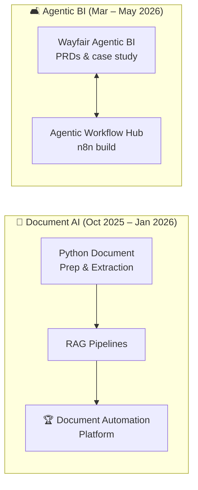

# Lashawn Fofung · Project Portfolio
### Technical Product Manager · AI Products, Agentic Workflows & Data-Driven Strategy

**The complete index of my work: every project, what it proves, and where to find it.**

MBA, IT Management · BIS, Clinical Informatics · PMP · CSPO · CSM · Oracle OCI Generative AI Professional

---

## Contents
[About Me](#about-me) · [Highlights](#highlights) · [AI Products](#-ai-products--agentic-systems) · [Product Strategy & UX](#-product-strategy--ux-research) · [Data & Decision Analysis](#-data--decision-analysis) · [Business Strategy](#-business-strategy) · [How Projects Connect](#how-projects-connect) · [Find by Skill](#find-by-skill) · [Portfolio Hubs](#portfolio-hubs) · [Certifications](#certifications) · [Contact](#contact)

---

## About Me

I'm a Technical Product Manager who works where **business, technology, and the user** meet. I can scope a product, build enough of it to understand the trade-offs, and test it with real people before asking a team to commit.

- 🩺 **Clinical roots.** As a Clinical Liaison, I learned to treat data and requirements with high-stakes rigor.
- 🏢 **Product delivery.** At **Optum**, I led digital enrollment enhancements and delivered user-centered work validated by **98% CSAT**.
- 🎓 **Business strategy.** An **MBA in IT Management** plus **PMP, CSPO, and CSM** certifications.
- 🤖 **Applied AI.** I write PRDs for agentic systems and build RAG pipelines myself.
- 🎨 **Design.** UI/UX training lets me balance what's viable, feasible, and right for the user.

**Open to:** Technical PM and AI PM roles, especially in healthcare, fintech, or AI-first teams.

---

## Highlights

| | Project | Proof point |
|---|---|---|
| 🏆 | [AI-Powered Document Automation Platform](https://github.com/LashawnFofung/AI-Powered-Document-Automation-Platform) | **Top Performer Award (Top 10%)** · [live demo](https://huggingface.co/spaces/lfofung/AI-Powered-Document-Intelligence-Automation-Platform) |
| 🤖 | [Wayfair Agentic BI](https://github.com/LashawnFofung/Wayfair-Agentic-BI) + [Agentic Workflow Hub](https://github.com/LashawnFofung/Agentic-Workflow-Hub) | 4 PRDs **and** 5 working n8n agents — spec and build |
| 📸 | [BeReal Passport & Community Boards](https://github.com/LashawnFofung/BeReal-RealProcess) | 4 of 5 testers would open the app more · [try the prototype](https://lashawnfofung.github.io/BeReal-RealProcess/) |
| 📊 | [Superstore Sales Performance](https://github.com/LashawnFofung/Superstore-Sales-Performance) | Found why $2.3M in sales yielded only a 12.47% profit ratio |
| 🚲 | [FO Tread Bikes (MBA Capstone)](https://github.com/LashawnFofung/FO-Tread-Bikes) | Revenue grew ~9× to $4.7M · industry-best Balanced Scorecard in Q2 and Q4 |

---

## 🤖 AI Products & Agentic Systems

| Project | What it is | Proof point | Stack |
|---|---|---|---|
| **[AI-Powered Document Automation Platform](https://github.com/LashawnFofung/AI-Powered-Document-Automation-Platform)** | Document AI MVP that splits multi-document PDFs, routes questions to the right document type, and answers with page-level citations | 🏆 Top 10% award · 6 demo videos · [live POC](https://huggingface.co/spaces/lfofung/AI-Powered-Document-Intelligence-Automation-Platform) | LlamaIndex · FAISS · Gemini · Mistral · Phi-2 · Gradio |
| **[RAG Pipelines](https://github.com/LashawnFofung/RAG-Pipelines)** | 16 notebooks from a basic chatbot to a document-routing RAG proof of concept | Timed benchmarks of 4 LLMs and 3 embedding models | LlamaIndex · Gemini · BGE · Gradio |
| **[Python Document Preparation & Extraction](https://github.com/LashawnFofung/Python-Document-Preparation-and-Extraction)** | 14 notebooks on cleaning data and extracting text, tables, and fields from mortgage PDFs and scans | Tesseract vs. PaddleOCR vs. EasyOCR comparison | PyMuPDF · pdfplumber · OpenCV · OCR |
| **[Wayfair Agentic BI](https://github.com/LashawnFofung/Wayfair-Agentic-BI)** | PM case study for a 5-agent market-intelligence pipeline | 4 PRDs · CIRCLES framing · dashboard prototype | PRDs · Base44 |
| **[Agentic Workflow Hub](https://github.com/LashawnFofung/Agentic-Workflow-Hub)** | The build behind Wayfair Agentic BI: five n8n labs, from a moodboard agent to an executive dashboard | Workflow JSON + sample reports for every agent | n8n · Gemini · Mistral · FLUX · Cheerio |

---

## 🎨 Product Strategy & UX Research

| Project | What it is | Proof point | Methods |
|---|---|---|---|
| **[BeReal Passport & Community Boards](https://github.com/LashawnFofung/BeReal-RealProcess)** | Re-engagement feature concept for casual BeReal users | 4 of 5 testers would open the app more · 4.2/5 low-pressure score | Teardown · persona · journey map · prototype · focus group |
| **[AI Personalization for Gen Z News](https://github.com/LashawnFofung/Digital-Product-AI-Strategy)** | Why Gen Z ignores and distrusts news personalization, and three features to fix it | 79% want to know why a story is recommended · metric targets per feature | Survey · personas · friction mapping · JTBD |

---

## 📊 Data & Decision Analysis

| Project | Business question | Headline finding | Tools |
|---|---|---|---|
| **[Superstore Sales Performance](https://github.com/LashawnFofung/Superstore-Sales-Performance)** | Why doesn't high revenue turn into profit? | $2.3M sales but a 12.47% profit ratio; Texas, Tables, and Bookcases lose margin | SQL · Tableau · WBS |
| **[CryptoPunks NFT Analysis](https://github.com/LashawnFofung/Cryptopunks-NFT-Analysis-Project)** | How volatile and concentrated is the market? | Top sale ~$11.1M; all five record sales came in 2021 | SQL (CTEs, window functions) |
| **[Superheroes Analysis](https://github.com/LashawnFofung/Super-Heroes-Analysis-Project)** | What patterns hide in 732 character records? | Marvel and DC make up 82% of heroes; ~30% of heights and weights were missing and had to be filtered out | SQL · Tableau |
| **[Nurse Attrition Regression](https://github.com/LashawnFofung/Nurse-Attrition-Linear-Regression-Analysis)** | Does a well-being program reduce nurse turnover? | Participation explains ~75% of attrition variation (p < 0.001); each +1% participation → −0.08 pts attrition | Excel regression |
| **[Drug Market Analysis](https://github.com/LashawnFofung/Drug-Market-Analysis)** | New drug, modified drug, or no change? | Modify the existing drug: ~40% higher expected value, robust down to a 28% success chance | Excel decision tree |

---

## 🚲 Business Strategy

| Project | What it is | Proof point | Tools |
|---|---|---|---|
| **[FO Tread Bikes (MBA Capstone)](https://github.com/LashawnFofung/FO-Tread-Bikes)** | Ran a bike-manufacturing company in a competitive market simulation: strategy, finance, operations, and marketing | Revenue grew ~9× to $4.7M · industry-best Balanced Scorecard in Q2 and Q4 · perfect 1.000 financial risk score · [business plan](https://youtu.be/fPxMes6A5BI) · [stockholder report](https://youtu.be/c9PEnwB_V0w) | Balanced Scorecard · Excel dashboards |

---

## How Projects Connect

Some projects are parts of one larger story:

- **Document AI:** clean the data → retrieve and answer from it → ship the award-winning MVP.
- **Agentic BI:** the PRDs and the working agents live side by side, so you can compare the spec with what shipped.

---

## Find by Skill

| Skill | Where to see it |
|---|---|
| **PRDs & product specs** | [Wayfair Agentic BI](https://github.com/LashawnFofung/Wayfair-Agentic-BI) |
| **User research & testing** | [BeReal](https://github.com/LashawnFofung/BeReal-RealProcess) · [Gen Z News](https://github.com/LashawnFofung/Digital-Product-AI-Strategy) |
| **Prototyping** | [BeReal](https://github.com/LashawnFofung/BeReal-RealProcess) · [Wayfair Agentic BI](https://github.com/LashawnFofung/Wayfair-Agentic-BI) · [Document Automation Platform](https://github.com/LashawnFofung/AI-Powered-Document-Automation-Platform) |
| **Success metrics & KPIs** | [Gen Z News](https://github.com/LashawnFofung/Digital-Product-AI-Strategy) · [Wayfair Agentic BI](https://github.com/LashawnFofung/Wayfair-Agentic-BI) · [FO Tread Bikes](https://github.com/LashawnFofung/FO-Tread-Bikes) |
| **RAG & LLM apps** | [Document Automation Platform](https://github.com/LashawnFofung/AI-Powered-Document-Automation-Platform) · [RAG Pipelines](https://github.com/LashawnFofung/RAG-Pipelines) |
| **Agentic workflows** | [Agentic Workflow Hub](https://github.com/LashawnFofung/Agentic-Workflow-Hub) |
| **Model evaluation** | [RAG Pipelines](https://github.com/LashawnFofung/RAG-Pipelines) · [Python Document Prep](https://github.com/LashawnFofung/Python-Document-Preparation-and-Extraction) |
| **Python & OCR** | [Python Document Prep](https://github.com/LashawnFofung/Python-Document-Preparation-and-Extraction) |
| **SQL** | [Superstore](https://github.com/LashawnFofung/Superstore-Sales-Performance) · [CryptoPunks](https://github.com/LashawnFofung/Cryptopunks-NFT-Analysis-Project) · [Superheroes](https://github.com/LashawnFofung/Super-Heroes-Analysis-Project) |
| **Tableau** | [Superstore](https://github.com/LashawnFofung/Superstore-Sales-Performance) · [Superheroes](https://github.com/LashawnFofung/Super-Heroes-Analysis-Project) |
| **Statistics & decision analysis** | [Nurse Attrition](https://github.com/LashawnFofung/Nurse-Attrition-Linear-Regression-Analysis) · [Drug Market](https://github.com/LashawnFofung/Drug-Market-Analysis) |
| **Project management (WBS, sprints)** | [Superstore](https://github.com/LashawnFofung/Superstore-Sales-Performance) · [Document Automation Platform](https://github.com/LashawnFofung/AI-Powered-Document-Automation-Platform) |
| **Business & financial strategy** | [FO Tread Bikes](https://github.com/LashawnFofung/FO-Tread-Bikes) · [Drug Market](https://github.com/LashawnFofung/Drug-Market-Analysis) |

---

## Portfolio Hubs

| Hub | Focus |
|---|---|
| [MBA & Product Portfolio](https://github.com/LashawnFofung/MBA-IT-Management-Portfolio) | My full PM story: AI products, PRDs, UX research, strategy |
| [AI Portfolio](https://github.com/LashawnFofung/AI-Portfolio) | Agentic systems, RAG, and the model benchmarks behind my decisions |
| [Data Analysis Portfolio](https://github.com/LashawnFofung/Data-Analysis-Portfolio) | SQL, Tableau, and Excel case studies |
| [GitHub Profile](https://github.com/LashawnFofung) | Quick overview and pinned projects |

---

## Certifications

- [PMP® — Project Management Professional](https://www.credly.com/badges/069386a1-7007-40f8-9773-f308e59e06db/public_url)
- [CSPO® — Certified Scrum Product Owner](https://badgecert.com/bc/html/groupbadges.html?k=NWR6TmMzUVRUbElJeVZ5c0RnclVnems0cTkybW0yb2Q)
- [CSM® — Certified ScrumMaster](https://badgecert.com/bc/html/groupbadges.html?k=NWR6TmMzUVRUbElJeVZ5c0RnclVnems0cTkybW0yb2Q)
- [Agile Coaching Skills](https://bcert.me/swzujlylo)
- Oracle Cloud Infrastructure 2025 Generative AI Professional
- Oracle Certified AI Foundations Associate

---

## Contact

**Open to Technical PM and AI PM roles** · 👉 [Let's connect on LinkedIn](https://www.linkedin.com/in/lashawnfofung/) · 🎥 [Demos on YouTube](https://www.youtube.com/@LashawnFofung)

